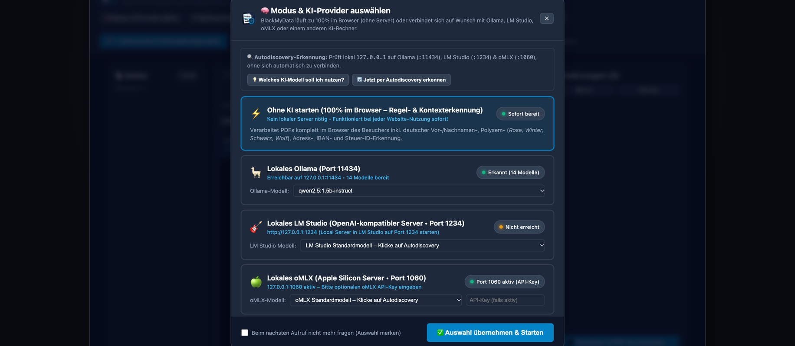

# 🛡️ BlackMyData

**Personenbezogene Daten in PDFs automatisch finden und wirklich schwärzen – lokal, ohne Upload.**

BlackMyData liest digitale und gescannte PDF-Dokumente ein, erkennt per OCR und deutscher PII-Erkennung Namen, Adressen, Kontodaten und mehr und entfernt sie dauerhaft. Auf Wunsch hilft ein lokales Sprachmodell (Ollama oder oMLX) mit. Für alle, die Dokumente weitergeben müssen, ohne dabei personenbezogene Daten mitzuschicken.

---

## Was BlackMyData kann

**Einlesen und erkennen**
- Beliebig viele PDFs per Drag & Drop, mit Warteschlange und Statusanzeige.
- Digitale PDFs, Scans und Bilddateien; Texterkennung mit Tesseract OCR (Deutsch und Englisch), wortgenau bis auf Pixelebene.

**Findet personenbezogene Daten – auch im Fließtext**
- Personennamen (z. B. nach *Herr*, *Frau*, *Dr.*, in Unterschriftenzeilen wie *gez.*)
- Anschriften: Straßen, Hausnummern, Postleitzahlen, Orte
- Kontaktdaten: E-Mail, Telefon- und Mobilnummern (deutsch und international)
- Finanzdaten: IBAN (per Prüfsumme geprüft), BIC/SWIFT, Kontonummern
- Behörden- und Steuerdaten: Steuer-ID, Steuernummer, Renten- und Krankenversichertennummer
- Datums- und Geburtsangaben in gängigen Schreibweisen
- Organisationen (GmbH, AG, e.V. …)
- Eigene Stichwörter oder Regex-Muster

**Schwärzt echt – nicht nur übermalt**
- Betroffene Seiten werden gerastert, die Schwärzung eingebrannt; die ursprüngliche Textebene ist danach nicht mehr enthalten. Seiten ohne Fundstelle bleiben unverändert.
- Seiten, auf denen die OCR fehlschlägt, werden vollständig geschwärzt statt ungeprüft übernommen. Formularfelder und Anmerkungen werden abgeflacht und ebenfalls geprüft.
- Treffer lassen sich im Editor einzeln an- und abschalten; Logos, Stempel oder handschriftliche Vermerke markierst du per Freihand-Rechteck.
- Download als einzelnes PDF (`dateiname_geschwaerzt.pdf`) oder gebündelt als ZIP.

**Nach deinen Vorstellungen**
- Schwärzungsstil: Schwarz, Dunkelgrau oder Weiß, optional mit Textlabel wie `[GESCHWÄRZT]` oder `[{CATEGORY}]`, einstellbare Polsterung.
- Datenkategorien einzeln an- und abwählbar; Whitelist für Begriffe, die nie geschwärzt werden sollen.
- Drei Modi: ⚡ **Turbo** (Regex & Heuristik, ~0.2 s/Seite), ⚖️ **Ausgewogen** (automatische Scan-Erkennung, 200-DPI-OCR), 🧠 **KI DeepScan** (lokales LLM liest den ganzen Text, 300-DPI-OCR).
- Ruhige Oberfläche mit Dark/Light Mode, Zoom, Seitennavigation und farbig sortierter Trefferliste.

**Lokale KI**
- Ollama (`http://127.0.0.1:11434`) wird automatisch erkannt, samt installierter Modelle.
- oMLX auf Port 1060 für Apple-Silicon-MLX-Modelle.

---

## Loslegen

- **macOS:** `BlackMyData.app` aus dem ZIP per Doppelklick öffnen. Beim ersten Start einmal Rechtsklick → „Öffnen“, weil die App nicht von Apple notarisiert ist. Läuft offline im eigenen Fenster.
- **Windows:** Installer oder portables ZIP – `BlackMyData.exe` startet die App ohne weitere Installation.
- **Android:** APK installieren (ab Android 8.0).
- **Im Browser:** [allinonemediamanager.de/blackmydata/run/](https://allinonemediamanager.de/blackmydata/run/) – läuft komplett im Browser, Dokumente verlassen das Gerät nicht.
- **Lokale KI:** `ollama serve` im Terminal starten – die App findet die Modelle sofort. Ist oMLX aktiv, erscheinen dessen Modelle in der Auswahl. Das Status-Badge oben rechts zeigt, welche KI bereitsteht.

## Download

| Plattform | Format | |
| :--- | :--- | :--- |
| **macOS** | `.zip` (`BlackMyData.app`) | Apple Silicon und Intel |
| **Windows** | `.exe` / `.zip` | Setup-Installer oder portabel |
| **Android** | `.apk` | ab Android 8.0 |
| **Web** | HTML / JS | im Browser, ohne Server-Upload |

- Projektseite & Downloads: **[allinonemediamanager.de/blackmydata/](https://allinonemediamanager.de/blackmydata/)**
- Direkt im Browser: **[allinonemediamanager.de/blackmydata/run/](https://allinonemediamanager.de/blackmydata/run/)**
- Alle Binärdateien: [Releases](https://git.juliandigitalproducts.de/jdaniels/BlackMyData/releases) (Dateinamen mit Version, z. B. `BlackMyData-Android-1.0.0.apk`)
- Quellcode: [git.juliandigitalproducts.de/jdaniels/BlackMyData](https://git.juliandigitalproducts.de/jdaniels/BlackMyData) · [GitHub](https://github.com/juliandigitalproducts/BlackMyData)

Bauen, Tests, CI und Signatur stehen in [docs/BUILD.md](docs/BUILD.md).

---

## Datenschutz

- Keine Telemetrie, keine Analyse, keine Konten: Dokumente und Einstellungen bleiben auf dem eigenen Gerät bzw. im Browser.
- Einzige Ausnahme: Wer einen KI-Server (Ollama, LM Studio, oMLX) einträgt, schickt den Dokumenttext an genau diesen Server. Standard ist `127.0.0.1`. Wird eine Adresse außerhalb des eigenen Netzes (z. B. ein Cloud-Anbieter) eingetragen, gehen Seitentext und bei der Vision-Korrektur Bildausschnitte dorthin – die App fragt dafür einmal pro Server ausdrücklich nach.
- Die Erkennung ist heuristisch. BlackMyData unterstützt beim Schwärzen, ersetzt aber keine Prüfung: Ergebnisse vor der Weitergabe kontrollieren (siehe Gewährleistungsausschluss, §§ 15–16 der [GPL-3.0](LICENSE)).

## Lizenz

Versionen bis einschließlich v1.0.7: MIT. Ab der nächsten Version: GPL-3.0-or-later.

BlackMyData ist freie Software unter der GNU General Public License, Version 3 oder (nach Wahl) jeder späteren Version – Volltext in [LICENSE](LICENSE). Zusätzliche Bedingungen nach § 7 GPLv3 (Marken, Kennzeichnung veränderter Versionen) stehen in [LICENSE-EXCEPTIONS.md](LICENSE-EXCEPTIONS.md). Eigene Quelldateien tragen den Header `SPDX-License-Identifier: GPL-3.0-or-later`.

Fremdkomponenten und ihre Lizenzen: [THIRD_PARTY_LICENSES.md](THIRD_PARTY_LICENSES.md); die Volltexte liegen in [`app/static/licenses/`](app/static/licenses/) und werden in jedes Paket (APK, Windows, macOS, Linux, Web) mitgeliefert – in der App unter „Datenschutz, Architektur & Lizenzen“.

Beiträge: siehe [CONTRIBUTING.md](CONTRIBUTING.md).

## Marken

Die Lizenz gewährt keine Rechte an den Namen „BlackMyData“ und „Julian Digital Products“ sowie an Logos, Icons und anderen Markenmerkmalen des Programms. Veränderte Versionen müssen unter einem anderen Namen und mit anderen Icons verbreitet werden, als verändert gekennzeichnet sein und dürfen nicht den Eindruck erwecken, vom ursprünglichen Autor zu stammen oder von ihm unterstützt zu werden. Bilder und Grafiken in diesem Repository sind Werke von Julian Digital Products und – sofern nicht anders angegeben – nicht zur Verwendung außerhalb dieses Programms lizenziert. Verbindlich ist der Wortlaut in [LICENSE-EXCEPTIONS.md](LICENSE-EXCEPTIONS.md).

## Anbieter

juliandigitalproducts · [juliandigitalproducts.de](https://juliandigitalproducts.de/) · [Impressum](https://juliandigitalproducts.de/impressum/) · [Datenschutzerklärung](https://juliandigitalproducts.de/datenschutzerklaerung/)
